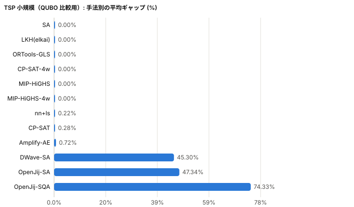
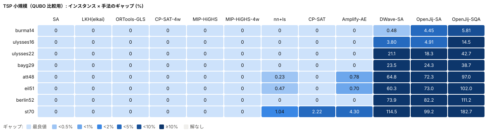

# ベンチマーク結果

このページは `python src/export_web.py` で自動生成しています（手で編集しないでください）。マウスオーバーで詳細が見られ、run を切り替えて比較できる対話型のビューは、手元で `docs/benchmark.html` をダブルクリックすると開きます（入口は `docs/index.html`）。

データ生成: 2026-10-26T15:07:28+00:00

- [TSP（対称巡回セールスマン）](#tsp) / [TSP 小規模（QUBO 比較用）](#tsp_small) / [ATSP（非対称巡回セールスマン）](#atsp) / [ATSP-TW（時間枠付き非対称巡回セールスマン）](#atsptw) / [JSSP（ジョブショップ）](#jssp) / [ナーススケジューリング](#nsp) / [実行履歴](#history)

## TSP（対称巡回セールスマン）

### 問題設定

n 個の都市と都市間の距離が与えられたとき、すべての都市をちょうど 1 回ずつ訪れて出発点に戻る巡回路のうち、総距離が最短のものを求める。距離は向きによらない（i から j へ行く距離と j から i へ行く距離が等しい）。配送や巡回の経路、プリント基板の穴あけ順序などに現れる、組合せ最適化の代表的な問題。

- **決めるもの**: 都市を回る順序（巡回路）。0-1 変数で書くと、x_ij = 1 は「都市 i の次に都市 j へ行く」ことを表す。
- **制約**:
  - 各都市にちょうど 1 回ずつ入り、ちょうど 1 回ずつ出る（各都市をちょうど 1 回訪れる）。
  - 全都市が 1 本の巡回路でつながる。一部の都市だけで閉じた小さな輪（部分巡回路）を作らない。
- **目的関数**: 巡回路の総距離 Σ d_ij x_ij を最小化する。

### インスタンス

TSPLIB95 から 52〜783 都市の 6 問を選んだ。どれも平面上の座標で与えられ、距離は 2 点間のユークリッド距離を整数に丸めた値。参照値は公表されている最適値で、ギャップはこれとの差で測る。

| インスタンス | 都市数 | 距離 | 内容 | 最適値 |
|---|---:|---|---|---:|
| berlin52 | 52 | 平面座標のユークリッド距離 | ベルリン市内の 52 地点（Grötschel） | 7,542 |
| kroA100 | 100 | 平面座標のユークリッド距離 | 平面上にランダムに置いた 100 都市（Krolak, Felts & Nelson） | 21,282 |
| ch150 | 150 | 平面座標のユークリッド距離 | 平面上の 150 都市（Churritz） | 6,528 |
| a280 | 280 | 平面座標のユークリッド距離 | プリント基板の穴あけ順序（Ludwig） | 2,579 |
| pcb442 | 442 | 平面座標のユークリッド距離 | プリント基板の穴あけ順序（Grötschel, Jünger & Reinelt） | 50,778 |
| rat783 | 783 | 平面座標のユークリッド距離 | 格子点を少しずつずらした 783 点（Pulleyblank） | 8,806 |

### 結果

run `20261025T075502Z-tiamat-tsp`（2026-10-25 07:55 UTC 開始）。参照値: TSPLIB 公表最適値。制限時間 60 秒、全手法 1 スレッド（CP-SAT-4w・MIP-HiGHS-4w は 4 スレッド）。確率的手法は複数シードの平均。

実行環境: tiamat: AMD Ryzen 9 5900HX with Radeon Graphics, 16 論理 CPU, メモリ 31.4 GB, Windows-11-10.0.26200-SP0, Python 3.12.9, ortools 9.15.6755, highspy 1.15.1, elkai 2.0.1, numba 0.68.0。コード: commit `bffb27c`

| 手法 | 平均ギャップ (%) | 平均順位 | 解あり | 最良値到達 | 平均時間 (秒) |
|---|---:|---:|---:|---:|---:|
| LKH(elkai) | 0.00 | 1.0 | 6/6 | 6 | 5.5 |
| SA | 0.51 | 2.2 | 6/6 | 3 | 60.0 |
| nn+ls | 0.83 | 2.5 | 6/6 | 2 | 15.4 |
| ORTools-GLS | 1.06 | 3.5 | 6/6 | 2 | 60.1 |
| CP-SAT-4w | 291.62 | 4.2 | 6/6 | 2 | 53.4 |
| CP-SAT | 20.33 | 6.8 | 5/6 | 1 | 53.9 |
| MIP-HiGHS-4w | 0.00 | 4.3 | 4/6 | 4 | 33.6 |
| MIP-HiGHS | 0.00 | 6.0 | 3/6 | 3 | 35.0 |
| DWave-SA | 73.42 | 10.7 | 1/6 | 0 | 9.8 |
| OpenJij-SA | 82.23 | 10.8 | 1/6 | 0 | 9.8 |
| OpenJij-SQA | 111.15 | 11.0 | 1/6 | 0 | 9.4 |

インスタンス別の平均ギャップ (%)。太字は各インスタンスの最良、× は制限時間内に実行可能解なし。

| インスタンス | LKH(elkai) | SA | nn+ls | ORTools-GLS | CP-SAT-4w | CP-SAT | MIP-HiGHS-4w | MIP-HiGHS | DWave-SA | OpenJij-SA | OpenJij-SQA |
|---|---:|---:|---:|---:|---:|---:|---:|---:|---:|---:|---:|
| berlin52 | **0** | **0** | **0** | **0** | **0** | **0** | **0** | **0** | 73.42 | 82.23 | 111.15 |
| kroA100 | **0** | **0** | **0** | **0** | **0** | 29.81 | **0** | **0** | × | × | × |
| ch150 | **0** | 0.32 | 0.24 | 0.54 | 1.36 | 31.76 | **0** | **0** | × | × | × |
| a280 | **0** | **0** | 0.47 | 0.50 | 8.65 | 19.74 | **0** | × | × | × | × |
| pcb442 | **0** | 1.03 | 0.88 | 1.87 | 18.58 | 20.34 | × | × | × | × | × |
| rat783 | **0** | 1.68 | 3.42 | 3.48 | 1721.11 | × | × | × | × | × | × |

### スレッド数による違い

平均ギャップ (%) と平均時間（秒）。× は制限時間内に実行可能解なし。平均は全スレッド数で解が得られたインスタンスのみ。

**CP-SAT**

| インスタンス | 1 スレッド | 時間 | 4 スレッド | 時間 |
|---|---:|---:|---:|---:|
| berlin52 | 0.00 | 9.2 | 0.00 | 4.5 |
| kroA100 | 29.81 | 60.5 | 0.00 | 60.5 |
| ch150 | 31.76 | 60.7 | 1.36 | 61.5 |
| a280 | 19.74 | 61.5 | 8.65 | 61.6 |
| pcb442 | 20.34 | 63.2 | 18.58 | 63.2 |
| rat783 | × | 68.6 | 1721.11 | 69.2 |
| 平均（5 問） | 20.33 | 51.0 | 5.72 | 50.2 |

**MIP-HiGHS**

| インスタンス | 1 スレッド | 時間 | 4 スレッド | 時間 |
|---|---:|---:|---:|---:|
| berlin52 | 0.00 | 0.1 | 0.00 | 0.1 |
| kroA100 | 0.00 | 4.0 | 0.00 | 3.5 |
| ch150 | 0.00 | 24.7 | 0.00 | 21.5 |
| a280 | × | 60.5 | 0.00 | 56.3 |
| pcb442 | × | 60.7 | × | 60.2 |
| rat783 | × | 60.2 | × | 60.3 |
| 平均（3 問） | 0.00 | 9.6 | 0.00 | 8.3 |

### 手法の解説

- **nn+ls**: 最近傍法（いちばん近い未訪問の都市へ順に進む）で巡回路を作り、2-opt（対称のときだけ）と Or-opt（1〜3 都市の区間の付け替え）で改善できなくなるまで局所探索する自作手法。始点を変えながら制限時間まで繰り返し、最良の巡回路を返す。実装が簡単で、他の手法を測る物差しになる。
- **SA**: 焼きなまし法（Simulated Annealing）。2-opt や Or-opt のランダムな変更を、悪くなる場合も「温度」に応じた確率で受け入れ、温度を徐々に下げることで局所最適から抜け出す自作手法。最後に局所探索で仕上げる。
- **LKH(elkai)**: Lin–Kernighan 法を発展させた Helsgaun の LKH を elkai パッケージ経由で呼ぶ。複数の辺をまとめて入れ替える強力な局所探索で、TSP の近似解法では最強クラス。ここでは時間ではなく試行回数（runs=10）で止めている。
- **ORTools-GLS**: Google OR-Tools の配送計画ソルバー（Routing）。安い弧から順につないで初期解を作り、誘導局所探索（GLS: 局所最適に何度も現れる辺にペナルティを課して別の解へ誘導する）で改善する。時間枠・容量・複数車両などの業務制約を足せる汎用性が強み。
- **CP-SAT**: OR-Tools の制約プログラミングソルバー CP-SAT。各弧を使うかどうかを 0-1 変数にし、AddCircuit 制約で「全都市を 1 本の巡回路で回る」ことを表して総距離を最小化する。下界も出すので、時間内に最適性を証明できることもある。
- **MIP-HiGHS**: 混合整数計画（MIP）をオープンソースのソルバー HiGHS で解く。まず各都市の次数の制約だけで解き、小さな輪（部分巡回路）が出るたびにそれを禁じる制約（DFJ）を足して解き直す。最適性を証明できるが、時間切れになると巡回路を返せない。
- **OpenJij-SQA**: 疑似量子アニーリング（SQA）。量子アニーリングの量子揺らぎを、解のコピー（Trotter スライス）を並べて互いに引き合わせる形で古典計算機上に再現する、OpenJij の実装。問題を QUBO（0/1 変数の二次式）に直し、1000 スイープ、Trotter 数 4、逆温度 20 で10 解ずつ求める呼び出しを制限時間まで繰り返して、制約を満たす最良の解を採る。
- **OpenJij-SA**: QUBO に対する焼きなまし法（SA）を OpenJij で実行する。変数を 1 つずつ反転させる単純な近傍で、温度を下げながらエネルギー（目的関数と罰金の和）を最小化する。OpenJij-SQA と同じ QUBO・同じ繰り返し方で、量子揺らぎの有無だけが違う比較対象。
- **DWave-SA**: D-Wave 社が公開している QUBO 向け焼きなまし法（dwave-samplers、旧 neal）。量子アニーラ実機の前に問題の定式化を確かめる用途で広く使われる、古典計算機上の基準となるソルバー。OpenJij と同じ QUBO を既定のスケジュール（1000 スイープ）で 10 解ずつ解き、制限時間まで繰り返す。

## TSP 小規模（QUBO 比較用）

### 問題設定

問題は TSP（対称巡回セールスマン）と同じ。量子・疑似量子アニーリング（QUBO 系の解法）は扱える変数の数に限りがあるため、数十都市までのインスタンスに絞り、すべての手法を同じ土俵で比べる。

- **決めるもの**: 都市を回る順序（巡回路）。0-1 変数で書くと、x_ij = 1 は「都市 i の次に都市 j へ行く」ことを表す。
- **制約**:
  - 各都市にちょうど 1 回ずつ入り、ちょうど 1 回ずつ出る（各都市をちょうど 1 回訪れる）。
  - 全都市が 1 本の巡回路でつながる。一部の都市だけで閉じた小さな輪（部分巡回路）を作らない。
- **目的関数**: 巡回路の総距離 Σ d_ij x_ij を最小化する。
- **補足**: QUBO 系の解法では、x_it = 1 を「都市 i を t 番目に訪れる」とする位置の 0/1 変数を使い、都市 0 を先頭に固定して (n − 1)² 個の変数にする。「各都市を 1 回」「各位置に 1 都市」の制約は、破ると目的関数に罰金が加わる形で表す。変数が 5,000 個を超える問題（72 都市以上）は解かずに「解なし」とする。

### インスタンス

TSPLIB95 から 14〜70 都市の 8 問を選んだ。距離の与え方は問題によって異なり、緯度経度から求めた地球上の距離（burma14・ulysses16・ulysses22）、距離行列（bayg29）、疑似ユークリッド距離（att48）、平面のユークリッド距離（eil51・berlin52・st70）が混ざる。参照値は公表されている最適値。

| インスタンス | 都市数 | 距離 | 内容 | QUBO の変数 | 最適値 |
|---|---:|---|---|---:|---:|
| burma14 | 14 | 緯度経度から求めた地球上の距離 | ミャンマーの 14 都市（Zaw Win） | 169 | 3,323 |
| ulysses16 | 16 | 緯度経度から求めた地球上の距離 | 『オデュッセイア』でオデュッセウスがたどった 16 地点（Grötschel & Padberg） | 225 | 6,859 |
| ulysses22 | 22 | 緯度経度から求めた地球上の距離 | 『オデュッセイア』でオデュッセウスがたどった 22 地点（Grötschel & Padberg） | 441 | 7,013 |
| bayg29 | 29 | 距離行列で直接与える | バイエルン州の 29 都市（Grötschel, Jünger & Reinelt） | 784 | 1,610 |
| att48 | 48 | 平面座標の疑似ユークリッド距離 | アメリカ本土 48 州の州都（Padberg & Rinaldi） | 2,209 | 10,628 |
| eil51 | 51 | 平面座標のユークリッド距離 | 平面上の 51 都市（Christofides & Eilon） | 2,500 | 426 |
| berlin52 | 52 | 平面座標のユークリッド距離 | ベルリン市内の 52 地点（Grötschel） | 2,601 | 7,542 |
| st70 | 70 | 平面座標のユークリッド距離 | 平面上の 70 都市（Smith & Thompson） | 4,761 | 675 |

### 結果

run `20261025T210045Z-tiamat-tsp_small`（2026-10-25 21:00 UTC 開始）。参照値: TSPLIB 公表最適値。制限時間 60 秒、全手法 1 スレッド（CP-SAT-4w・MIP-HiGHS-4w は 4 スレッド）。確率的手法は複数シードの平均。

実行環境: tiamat: AMD Ryzen 9 5900HX with Radeon Graphics, 16 論理 CPU, メモリ 31.4 GB, Windows-11-10.0.26200-SP0, Python 3.12.9, ortools 9.15.6755, highspy 1.15.1, elkai 2.0.1, numba 0.68.0。コード: commit `8e07417`

| 手法 | 平均ギャップ (%) | 平均順位 | 解あり | 最良値到達 | 平均時間 (秒) |
|---|---:|---:|---:|---:|---:|
| SA | 0.00 | 1.0 | 8/8 | 8 | 60.0 |
| LKH(elkai) | 0.00 | 1.0 | 8/8 | 8 | 0.0 |
| ORTools-GLS | 0.00 | 1.0 | 8/8 | 8 | 60.1 |
| CP-SAT-4w | 0.00 | 1.0 | 8/8 | 8 | 5.1 |
| MIP-HiGHS | 0.00 | 1.0 | 8/8 | 8 | 0.3 |
| MIP-HiGHS-4w | 0.00 | 1.0 | 8/8 | 8 | 0.3 |
| nn+ls | 0.22 | 3.5 | 8/8 | 5 | 0.8 |
| CP-SAT | 0.28 | 1.9 | 8/8 | 7 | 19.4 |
| DWave-SA | 45.30 | 9.2 | 8/8 | 0 | 59.0 |
| OpenJij-SA | 47.34 | 9.8 | 8/8 | 0 | 59.2 |
| OpenJij-SQA | 74.33 | 11.0 | 8/8 | 0 | 56.9 |

インスタンス別の平均ギャップ (%)。太字は各インスタンスの最良、× は制限時間内に実行可能解なし。

| インスタンス | SA | LKH(elkai) | ORTools-GLS | CP-SAT-4w | MIP-HiGHS | MIP-HiGHS-4w | nn+ls | CP-SAT | DWave-SA | OpenJij-SA | OpenJij-SQA |
|---|---:|---:|---:|---:|---:|---:|---:|---:|---:|---:|---:|
| burma14 | **0** | **0** | **0** | **0** | **0** | **0** | **0** | **0** | 0.48 | 4.45 | 5.81 |
| ulysses16 | **0** | **0** | **0** | **0** | **0** | **0** | **0** | **0** | 3.80 | 4.91 | 14.49 |
| ulysses22 | **0** | **0** | **0** | **0** | **0** | **0** | **0** | **0** | 21.06 | 18.34 | 42.73 |
| bayg29 | **0** | **0** | **0** | **0** | **0** | **0** | **0** | **0** | 23.50 | 24.29 | 38.74 |
| att48 | **0** | **0** | **0** | **0** | **0** | **0** | 0.23 | **0** | 64.84 | 72.29 | 97.04 |
| eil51 | **0** | **0** | **0** | **0** | **0** | **0** | 0.47 | **0** | 60.33 | 73.00 | 102.03 |
| berlin52 | **0** | **0** | **0** | **0** | **0** | **0** | **0** | **0** | 73.92 | 82.23 | 111.15 |
| st70 | **0** | **0** | **0** | **0** | **0** | **0** | 1.04 | 2.22 | 114.47 | 99.21 | 182.67 |

### スレッド数による違い

平均ギャップ (%) と平均時間（秒）。× は制限時間内に実行可能解なし。平均は全スレッド数で解が得られたインスタンスのみ。

**CP-SAT**

| インスタンス | 1 スレッド | 時間 | 4 スレッド | 時間 |
|---|---:|---:|---:|---:|
| burma14 | 0.00 | 0.4 | 0.00 | 0.4 |
| ulysses16 | 0.00 | 0.5 | 0.00 | 0.5 |
| ulysses22 | 0.00 | 3.1 | 0.00 | 3.1 |
| bayg29 | 0.00 | 1.1 | 0.00 | 1.0 |
| att48 | 0.00 | 60.4 | 0.00 | 4.8 |
| eil51 | 0.00 | 19.9 | 0.00 | 4.5 |
| berlin52 | 0.00 | 9.4 | 0.00 | 4.2 |
| st70 | 2.22 | 60.4 | 0.00 | 22.1 |
| 平均（8 問） | 0.28 | 19.4 | 0.00 | 5.1 |

**MIP-HiGHS**

| インスタンス | 1 スレッド | 時間 | 4 スレッド | 時間 |
|---|---:|---:|---:|---:|
| burma14 | 0.00 | 0.0 | 0.00 | 0.0 |
| ulysses16 | 0.00 | 0.1 | 0.00 | 0.1 |
| ulysses22 | 0.00 | 0.1 | 0.00 | 0.1 |
| bayg29 | 0.00 | 0.1 | 0.00 | 0.1 |
| att48 | 0.00 | 0.8 | 0.00 | 0.7 |
| eil51 | 0.00 | 0.5 | 0.00 | 0.5 |
| berlin52 | 0.00 | 0.1 | 0.00 | 0.1 |
| st70 | 0.00 | 0.7 | 0.00 | 0.6 |
| 平均（8 問） | 0.00 | 0.3 | 0.00 | 0.3 |

### 手法の解説

- **nn+ls**: 最近傍法（いちばん近い未訪問の都市へ順に進む）で巡回路を作り、2-opt（対称のときだけ）と Or-opt（1〜3 都市の区間の付け替え）で改善できなくなるまで局所探索する自作手法。始点を変えながら制限時間まで繰り返し、最良の巡回路を返す。実装が簡単で、他の手法を測る物差しになる。
- **SA**: 焼きなまし法（Simulated Annealing）。2-opt や Or-opt のランダムな変更を、悪くなる場合も「温度」に応じた確率で受け入れ、温度を徐々に下げることで局所最適から抜け出す自作手法。最後に局所探索で仕上げる。
- **LKH(elkai)**: Lin–Kernighan 法を発展させた Helsgaun の LKH を elkai パッケージ経由で呼ぶ。複数の辺をまとめて入れ替える強力な局所探索で、TSP の近似解法では最強クラス。ここでは時間ではなく試行回数（runs=10）で止めている。
- **ORTools-GLS**: Google OR-Tools の配送計画ソルバー（Routing）。安い弧から順につないで初期解を作り、誘導局所探索（GLS: 局所最適に何度も現れる辺にペナルティを課して別の解へ誘導する）で改善する。時間枠・容量・複数車両などの業務制約を足せる汎用性が強み。
- **CP-SAT**: OR-Tools の制約プログラミングソルバー CP-SAT。各弧を使うかどうかを 0-1 変数にし、AddCircuit 制約で「全都市を 1 本の巡回路で回る」ことを表して総距離を最小化する。下界も出すので、時間内に最適性を証明できることもある。
- **MIP-HiGHS**: 混合整数計画（MIP）をオープンソースのソルバー HiGHS で解く。まず各都市の次数の制約だけで解き、小さな輪（部分巡回路）が出るたびにそれを禁じる制約（DFJ）を足して解き直す。最適性を証明できるが、時間切れになると巡回路を返せない。
- **OpenJij-SQA**: 疑似量子アニーリング（SQA）。量子アニーリングの量子揺らぎを、解のコピー（Trotter スライス）を並べて互いに引き合わせる形で古典計算機上に再現する、OpenJij の実装。問題を QUBO（0/1 変数の二次式）に直し、1000 スイープ、Trotter 数 4、逆温度 20 で10 解ずつ求める呼び出しを制限時間まで繰り返して、制約を満たす最良の解を採る。
- **OpenJij-SA**: QUBO に対する焼きなまし法（SA）を OpenJij で実行する。変数を 1 つずつ反転させる単純な近傍で、温度を下げながらエネルギー（目的関数と罰金の和）を最小化する。OpenJij-SQA と同じ QUBO・同じ繰り返し方で、量子揺らぎの有無だけが違う比較対象。
- **DWave-SA**: D-Wave 社が公開している QUBO 向け焼きなまし法（dwave-samplers、旧 neal）。量子アニーラ実機の前に問題の定式化を確かめる用途で広く使われる、古典計算機上の基準となるソルバー。OpenJij と同じ QUBO を既定のスケジュール（1000 スイープ）で 10 解ずつ解き、制限時間まで繰り返す。

## ATSP（非対称巡回セールスマン）

### 問題設定

TSP と同じく、すべての都市をちょうど 1 回ずつ訪れて出発点に戻る最短の巡回路を求める。ただし距離が向きによって異なってよい（i から j と j から i で距離が違う）。一方通行や上り下りのある移動のほか、前の品種によって段取り替えの時間が変わる生産順序の決定などに現れる。

- **決めるもの**: 都市を回る順序（巡回路）。0-1 変数で書くと、x_ij = 1 は「都市 i の次に都市 j へ行く」ことを表す（向きつき）。
- **制約**:
  - 各都市にちょうど 1 回ずつ入り、ちょうど 1 回ずつ出る（各都市をちょうど 1 回訪れる）。
  - 全都市が 1 本の巡回路でつながる。一部の都市だけで閉じた小さな輪（部分巡回路）を作らない。
- **目的関数**: 巡回路の総距離 Σ d_ij x_ij を最小化する。

### インスタンス

TSPLIB95 から 34〜443 都市の 6 問を選んだ。距離はすべて行列で直接与えられる。名前の数字と都市数がずれるものがある（ftv33 は 34 都市、kro124p は 100 都市）。rbg323・rbg443 は自動倉庫のスタッカークレーンの作業順序から作られた実務由来の問題。参照値は公表されている最適値。

| インスタンス | 都市数 | 内容 | 最適値 |
|---|---:|---|---:|
| ftv33 | 34 | 都市部での医薬品配送（Fischetti, Toth & Vigo） | 1,286 |
| ftv70 | 71 | 都市部での医薬品配送（Fischetti, Toth & Vigo） | 1,950 |
| kro124p | 100 | kroA100 の距離を一部変えて非対称にしたもの（Fischetti & Toth） | 36,230 |
| ft70 | 70 | 非対称の 70 都市（Fischetti & Toth） | 38,673 |
| rbg323 | 323 | 自動倉庫のスタッカークレーンの作業順序（Ascheuer） | 1,326 |
| rbg443 | 443 | 自動倉庫のスタッカークレーンの作業順序（Ascheuer） | 2,720 |

### 結果

run `20261025T081323Z-tiamat-atsp`（2026-10-25 08:13 UTC 開始）。参照値: TSPLIB 公表最適値。制限時間 60 秒、全手法 1 スレッド（CP-SAT-4w・MIP-HiGHS-4w は 4 スレッド）。確率的手法は複数シードの平均。

実行環境: tiamat: AMD Ryzen 9 5900HX with Radeon Graphics, 16 論理 CPU, メモリ 31.4 GB, Windows-11-10.0.26200-SP0, Python 3.12.9, ortools 9.15.6755, highspy 1.15.1, elkai 2.0.1, numba 0.68.0。コード: commit `bffb27c`

| 手法 | 平均ギャップ (%) | 平均順位 | 解あり | 最良値到達 | 平均時間 (秒) |
|---|---:|---:|---:|---:|---:|
| LKH(elkai) | 0.00 | 1.0 | 6/6 | 6 | 8.0 |
| SA | 0.08 | 3.5 | 6/6 | 3 | 60.0 |
| PyVRP-HGS | 0.29 | 4.8 | 6/6 | 1 | 60.1 |
| ORTools-GLS | 0.96 | 4.7 | 6/6 | 2 | 60.1 |
| nn+ls | 3.03 | 7.7 | 6/6 | 0 | 6.4 |
| CP-SAT-4w | 9.83 | 1.8 | 6/6 | 5 | 20.9 |
| CP-SAT | 18.88 | 3.3 | 6/6 | 4 | 26.3 |
| MIP-HiGHS | 0.00 | 4.7 | 4/6 | 4 | 22.9 |
| MIP-HiGHS-4w | 0.00 | 4.7 | 4/6 | 4 | 23.0 |
| DWave-SA | 62.22 | 11.0 | 3/6 | 0 | 28.0 |
| OpenJij-SA | 80.37 | 11.5 | 3/6 | 0 | 29.6 |
| OpenJij-SQA | 112.63 | 12.0 | 3/6 | 0 | 27.2 |

インスタンス別の平均ギャップ (%)。太字は各インスタンスの最良、× は制限時間内に実行可能解なし。

| インスタンス | LKH(elkai) | SA | PyVRP-HGS | ORTools-GLS | nn+ls | CP-SAT-4w | CP-SAT | MIP-HiGHS | MIP-HiGHS-4w | DWave-SA | OpenJij-SA | OpenJij-SQA |
|---|---:|---:|---:|---:|---:|---:|---:|---:|---:|---:|---:|---:|
| ftv33 | **0** | **0** | **0** | **0** | 4.20 | **0** | **0** | **0** | **0** | 34.58 | 47.02 | 76.18 |
| ftv70 | **0** | 0.43 | 0.36 | **0** | 3.44 | **0** | **0** | **0** | **0** | 105.95 | 142.74 | 200.51 |
| kro124p | **0** | **0** | 0.76 | 2.02 | 4.79 | **0** | 8.96 | **0** | **0** | × | × | × |
| ft70 | **0** | 0.03 | 0.23 | 0.41 | 1.92 | **0** | **0** | **0** | **0** | 46.14 | 51.34 | 61.20 |
| rbg323 | **0** | 0.03 | 0.33 | 2.71 | 3.39 | **0** | **0** | × | × | × | × | × |
| rbg443 | **0** | **0** | 0.07 | 0.62 | 0.44 | 58.97 | 104.34 | × | × | × | × | × |

### スレッド数による違い

平均ギャップ (%) と平均時間（秒）。× は制限時間内に実行可能解なし。平均は全スレッド数で解が得られたインスタンスのみ。

**CP-SAT**

| インスタンス | 1 スレッド | 時間 | 4 スレッド | 時間 |
|---|---:|---:|---:|---:|
| ftv33 | 0.00 | 1.3 | 0.00 | 0.9 |
| ftv70 | 0.00 | 20.3 | 0.00 | 12.5 |
| kro124p | 8.96 | 60.5 | 0.00 | 32.8 |
| ft70 | 0.00 | 3.0 | 0.00 | 3.4 |
| rbg323 | 0.00 | 9.3 | 0.00 | 12.7 |
| rbg443 | 104.34 | 63.5 | 58.97 | 63.2 |
| 平均（6 問） | 18.88 | 26.3 | 9.83 | 20.9 |

**MIP-HiGHS**

| インスタンス | 1 スレッド | 時間 | 4 スレッド | 時間 |
|---|---:|---:|---:|---:|
| ftv33 | 0.00 | 0.2 | 0.00 | 0.2 |
| ftv70 | 0.00 | 2.8 | 0.00 | 2.3 |
| kro124p | 0.00 | 10.2 | 0.00 | 8.9 |
| ft70 | 0.00 | 1.7 | 0.00 | 1.5 |
| rbg323 | × | 62.0 | × | 65.4 |
| rbg443 | × | 60.4 | × | 59.6 |
| 平均（4 問） | 0.00 | 3.7 | 0.00 | 3.2 |

### 手法の解説

- **nn+ls**: 最近傍法（いちばん近い未訪問の都市へ順に進む）で巡回路を作り、2-opt（対称のときだけ）と Or-opt（1〜3 都市の区間の付け替え）で改善できなくなるまで局所探索する自作手法。始点を変えながら制限時間まで繰り返し、最良の巡回路を返す。実装が簡単で、他の手法を測る物差しになる。
- **SA**: 焼きなまし法（Simulated Annealing）。2-opt や Or-opt のランダムな変更を、悪くなる場合も「温度」に応じた確率で受け入れ、温度を徐々に下げることで局所最適から抜け出す自作手法。最後に局所探索で仕上げる。
- **LKH(elkai)**: Lin–Kernighan 法を発展させた Helsgaun の LKH を elkai パッケージ経由で呼ぶ。複数の辺をまとめて入れ替える強力な局所探索で、TSP の近似解法では最強クラス。ここでは時間ではなく試行回数（runs=10）で止めている。
- **ORTools-GLS**: Google OR-Tools の配送計画ソルバー（Routing）。安い弧から順につないで初期解を作り、誘導局所探索（GLS: 局所最適に何度も現れる辺にペナルティを課して別の解へ誘導する）で改善する。時間枠・容量・複数車両などの業務制約を足せる汎用性が強み。
- **CP-SAT**: OR-Tools の制約プログラミングソルバー CP-SAT。各弧を使うかどうかを 0-1 変数にし、AddCircuit 制約で「全都市を 1 本の巡回路で回る」ことを表して総距離を最小化する。下界も出すので、時間内に最適性を証明できることもある。
- **MIP-HiGHS**: 混合整数計画（MIP）をオープンソースのソルバー HiGHS で解く。まず各都市の次数の制約だけで解き、小さな輪（部分巡回路）が出るたびにそれを禁じる制約（DFJ）を足して解き直す。最適性を証明できるが、時間切れになると巡回路を返せない。
- **PyVRP-HGS**: 配送計画ライブラリ PyVRP のハイブリッド遺伝的探索（HGS）。解の集団を交叉させ、生まれた子を局所探索で磨く遺伝的アルゴリズムで、Vidal の HGS を基にした最先端の配送計画ソルバー。車両 1 台・容量なしの配送計画として、非対称の距離をそのまま使って解く。
- **OpenJij-SQA**: 疑似量子アニーリング（SQA）。量子アニーリングの量子揺らぎを、解のコピー（Trotter スライス）を並べて互いに引き合わせる形で古典計算機上に再現する、OpenJij の実装。問題を QUBO（0/1 変数の二次式）に直し、1000 スイープ、Trotter 数 4、逆温度 20 で10 解ずつ求める呼び出しを制限時間まで繰り返して、制約を満たす最良の解を採る。
- **OpenJij-SA**: QUBO に対する焼きなまし法（SA）を OpenJij で実行する。変数を 1 つずつ反転させる単純な近傍で、温度を下げながらエネルギー（目的関数と罰金の和）を最小化する。OpenJij-SQA と同じ QUBO・同じ繰り返し方で、量子揺らぎの有無だけが違う比較対象。
- **DWave-SA**: D-Wave 社が公開している QUBO 向け焼きなまし法（dwave-samplers、旧 neal）。量子アニーラ実機の前に問題の定式化を確かめる用途で広く使われる、古典計算機上の基準となるソルバー。OpenJij と同じ QUBO を既定のスケジュール（1000 スイープ）で 10 解ずつ解き、制限時間まで繰り返す。

## ATSP-TW（時間枠付き非対称巡回セールスマン）

### 問題設定

デポ（都市 0）を出発し、各都市をちょうど 1 回ずつ、それぞれに決められた時間枠 [r_i, d_i] の中で訪れてデポに戻る巡回路のうち、移動時間の合計が最小のものを求める。移動時間は向きによって異なってよい。時間指定のある配送や、作業ごとに開始可能時刻と締め切りがある作業順序の決定に現れる。

- **決めるもの**: 都市を回る順序と、各都市での作業開始時刻 t_i。0-1 変数で書くと、x_ij = 1 は「都市 i の次に都市 j へ行く」ことを表す。
- **制約**:
  - 各都市をちょうど 1 回訪れ、全都市が 1 本の巡回路でつながる（部分巡回路を作らない）。
  - 時間枠: r_i ≤ t_i ≤ d_i。r_i より早く着いたら r_i まで待つ（待ち時間は費用にならない）。d_i より遅れて着くのは実行不能。
  - 時刻のつじつま: 都市 i の次に都市 j へ行くなら t_j ≥ t_i + c_ij（c_ij は i での作業時間を含む移動時間）。
  - デポに戻る時刻は、デポの締め切り d_0 までに収める。
- **目的関数**: 通った弧の移動時間の合計 Σ c_ij x_ij を最小化する（待ち時間は含めない）。

### インスタンス

Ascheuer が自動倉庫のスタッカークレーンの作業順序から作った rbg 系（AFG セット）の 9 問で、デポを含め20〜232 都市。López-Ibáñez の TSPTW インスタンス集で公表されている最適値（9 問とも最適性が証明済み）を参照値にした。時間枠の幅はほとんどの都市で 600（rbg019a は 300、rbg027a は約 1,700）で、デポに戻る締め切りまでの計画期間（約 6,000〜53,000）に比べてかなり狭い。

| インスタンス | 都市数（デポを含む） | 時間枠の幅（中央値） | デポに戻る締め切り | 最適値 |
|---|---:|---:|---:|---:|
| rbg019a | 20 | 300 | 5,900 | 1,262 |
| rbg027a | 28 | 1,712 | 10,434 | 5,091 |
| rbg041a | 42 | 600 | 8,702 | 2,598 |
| rbg055a | 56 | 600 | 14,944 | 3,761 |
| rbg067a | 68 | 600 | 21,748 | 4,625 |
| rbg092a | 93 | 600 | 26,100 | 7,158 |
| rbg125a | 126 | 600 | 29,420 | 7,936 |
| rbg172a | 173 | 600 | 36,574 | 10,950 |
| rbg233 | 232 | 600 | 53,386 | 14,992 |

### 結果

run `20261025T111518Z-tiamat-atsptw`（2026-10-25 11:15 UTC 開始）。参照値: 公表最適値（AFG セット）。制限時間 60 秒、全手法 1 スレッド（CP-SAT-4w・MIP-HiGHS-4w は 4 スレッド）。確率的手法は複数シードの平均。

実行環境: tiamat: AMD Ryzen 9 5900HX with Radeon Graphics, 16 論理 CPU, メモリ 31.4 GB, Windows-11-10.0.26200-SP0, Python 3.12.9, ortools 9.15.6755, highspy 1.15.1, elkai 2.0.1, numba 0.68.0。コード: commit `c8ce3fb`

| 手法 | 平均ギャップ (%) | 平均順位 | 解あり | 最良値到達 | 平均時間 (秒) |
|---|---:|---:|---:|---:|---:|
| PyVRP-HGS | 0.00 | 1.0 | 9/9 | 9 | 60.1 |
| GVNS | 0.02 | 1.2 | 9/9 | 7 | 60.0 |
| EDD+LS | 0.60 | 5.1 | 9/9 | 2 | 0.2 |
| CP-SAT-4w | 0.04 | 3.6 | 7/9 | 5 | 34.9 |
| LKH-3(elkai) | 0.07 | 4.6 | 7/9 | 3 | 60.0 |
| CP-SAT | 0.25 | 3.9 | 7/9 | 5 | 37.1 |
| MIP-HiGHS | 0.68 | 5.8 | 5/9 | 3 | 48.6 |
| MIP-HiGHS-4w | 0.68 | 5.8 | 5/9 | 3 | 47.5 |
| ORTools-GLS | 0.00 | 5.4 | 4/9 | 4 | 27.0 |

インスタンス別の平均ギャップ (%)。太字は各インスタンスの最良、× は制限時間内に実行可能解なし。

| インスタンス | PyVRP-HGS | GVNS | EDD+LS | CP-SAT-4w | LKH-3(elkai) | CP-SAT | MIP-HiGHS | MIP-HiGHS-4w | ORTools-GLS |
|---|---:|---:|---:|---:|---:|---:|---:|---:|---:|
| rbg019a | **0** | **0** | **0** | **0** | **0** | **0** | **0** | **0** | **0** |
| rbg027a | **0** | **0** | **0** | **0** | **0** | **0** | × | × | × |
| rbg041a | **0** | **0** | 2.23 | **0** | 0.40 | **0** | 0.46 | 0.46 | × |
| rbg055a | **0** | **0** | 0.11 | **0** | 0.03 | **0** | **0** | **0** | **0** |
| rbg067a | **0** | **0** | 0.09 | **0** | **0** | **0** | **0** | **0** | **0** |
| rbg092a | **0** | **0** | 0.31 | 0.11 | 0.07 | 0.15 | 2.95 | 2.95 | × |
| rbg125a | **0** | **0** | 0.76 | 0.14 | 0.00 | 1.57 | × | × | **0** |
| rbg172a | **0** | 0.03 | 0.93 | × | × | × | × | × | × |
| rbg233 | **0** | 0.14 | 0.96 | × | × | × | × | × | × |

### スレッド数による違い

平均ギャップ (%) と平均時間（秒）。× は制限時間内に実行可能解なし。平均は全スレッド数で解が得られたインスタンスのみ。

**CP-SAT**

| インスタンス | 1 スレッド | 時間 | 4 スレッド | 時間 |
|---|---:|---:|---:|---:|
| rbg019a | 0.00 | 1.5 | 0.00 | 0.4 |
| rbg027a | 0.00 | 12.0 | 0.00 | 2.3 |
| rbg041a | 0.00 | 60.4 | 0.00 | 60.4 |
| rbg055a | 0.00 | 4.5 | 0.00 | 2.9 |
| rbg067a | 0.00 | 12.3 | 0.00 | 5.3 |
| rbg092a | 0.15 | 60.5 | 0.11 | 60.5 |
| rbg125a | 1.57 | 60.6 | 0.14 | 60.5 |
| rbg172a | × | 60.7 | × | 60.7 |
| rbg233 | × | 61.0 | × | 60.9 |
| 平均（7 問） | 0.25 | 30.3 | 0.04 | 27.5 |

**MIP-HiGHS**

| インスタンス | 1 スレッド | 時間 | 4 スレッド | 時間 |
|---|---:|---:|---:|---:|
| rbg019a | 0.00 | 0.1 | 0.00 | 0.1 |
| rbg027a | × | 60.0 | × | 60.0 |
| rbg041a | 0.46 | 60.0 | 0.46 | 60.0 |
| rbg055a | 0.00 | 35.9 | 0.00 | 31.1 |
| rbg067a | 0.00 | 41.1 | 0.00 | 35.7 |
| rbg092a | 2.95 | 60.1 | 2.95 | 60.1 |
| rbg125a | × | 60.1 | × | 60.1 |
| rbg172a | × | 60.3 | × | 60.1 |
| rbg233 | × | 60.1 | × | 60.1 |
| 平均（5 問） | 0.68 | 39.4 | 0.68 | 37.4 |

### 手法の解説

- **EDD+LS**: 時間枠の締め切りが早い順（Earliest Due Date）に並べた巡回路から始め、Or-opt（1〜3 地点の付け替え）と 2 地点の交換で、まず遅れの合計を、次に総移動時間を減らす局所探索。決定的で一瞬で終わる、実務でまず試す素朴な方法。
- **GVNS**: 一般化変近傍探索（General Variable Neighborhood Search）。いまの解をランダムに k 回崩してから局所探索をかけ、良くなれば受け入れて k=1 に戻し、だめなら k を増やしてより大きく崩す。da Silva & Urrutia (2010) にならった自作版。
- **LKH-3(elkai)**: LKH の後継で、制約付きの巡回路問題を扱える LKH-3 を時間枠付き巡回セールスマン問題（TSPTW）として呼ぶ。時間枠の違反をペナルティとして扱いながら LK 型の局所探索を行い、制限時間いっぱい試行を繰り返す。
- **ORTools-GLS**: OR-Tools の配送計画ソルバー（Routing）に「時刻」の次元を加えて、各地点の到着時刻を時間枠に収める。挿入法で初期解を作り、誘導局所探索（GLS）で改善する。
- **CP-SAT**: CP-SAT で、弧の 0-1 変数と AddCircuit 制約で巡回路を表し、各地点の開始時刻の整数変数に「弧を使うなら次の地点は移動時間ぶん後に始まる」条件を付けたモデル。解と同時に下界を出し、最適性を証明できる。
- **MIP-HiGHS**: 弧の 0-1 変数と各地点の開始時刻の連続変数を、big-M 制約（弧を使うときだけ時刻の順序を強制する）で結んだ定式化を HiGHS で解く。時刻の制約が部分巡回路も防ぐ。big-M は緩和が弱く、大きな問題は苦手。
- **PyVRP-HGS**: 配送計画ライブラリ PyVRP のハイブリッド遺伝的探索（HGS）。解の集団を交叉させ、生まれた子を局所探索で磨く遺伝的アルゴリズムで、Vidal の HGS を基にした最先端の配送計画ソルバー。車両 1 台・時間枠付きの配送計画として解く。

## JSSP（ジョブショップ）

### 問題設定

n 個のジョブを m 台の機械で加工する。各ジョブは決まった順序で機械を 1 台ずつ回り（回る順序はジョブごとに異なる）、各工程の処理時間は決まっている。すべての工程の開始時刻を決めて、最後の工程が終わる時刻（メイクスパン）を最小にする。多品種少量生産の工場で、機械ごとの作業の順番を決める問題の基本形。

- **決めるもの**: 各工程 o の開始時刻 s_o（整数）。同じ機械で処理する工程の順番を決めることと同じで、MIP では同じ機械の 2 工程のどちらを先にするかを表す 0-1 変数も使う。
- **制約**:
  - ジョブ内の順序: 同じジョブの前の工程が終わるまで、次の工程を始められない（s_次 ≥ s_前 + p_前、p は処理時間）。
  - 機械の容量: 1 台の機械は同時に 1 つの工程しか処理できない（同じ機械の工程の処理時間帯が重ならない）。
  - 工程は始めたら途中で中断しない。
- **目的関数**: メイクスパン C_max = max_o (s_o + p_o) を最小化する。

### インスタンス

JSPLIB（OR-Library 形式）から 6×6〜20×20 の 10 問を選んだ。各ジョブはすべての機械を 1 回ずつ通るので、工程数はジョブ数 × 機械数になる。1963 年の Fisher & Thompson の古典問題から、難しいことで知られる Storer らや Taillard の問題まで含む。参照値は既知の最適値（ta11・ta21 は JSPLIB では未解決扱いだが、その後に最適性が証明された文献値）。

| インスタンス | ジョブ数 × 機械数 | 工程数 | 出典 | 最適値 |
|---|---|---:|---|---:|
| ft06 | 6 × 6 | 36 | Fisher & Thompson (1963) | 55 |
| ft10 | 10 × 10 | 100 | Fisher & Thompson (1963) | 930 |
| la16 | 10 × 10 | 100 | Lawrence (1984) | 945 |
| la21 | 15 × 10 | 150 | Lawrence (1984) | 1,046 |
| abz5 | 10 × 10 | 100 | Adams, Balas & Zawack (1988) | 1,234 |
| orb01 | 10 × 10 | 100 | Applegate & Cook (1991) | 1,059 |
| ta01 | 15 × 15 | 225 | Taillard (1993) | 1,231 |
| swv01 | 20 × 10 | 200 | Storer, Wu & Vaccari (1992) | 1,407 |
| ta11 | 20 × 15 | 300 | Taillard (1993) | 1,357 |
| ta21 | 20 × 20 | 400 | Taillard (1993) | 1,642 |

### 結果

run `20261025T082601Z-tiamat-jssp`（2026-10-25 08:26 UTC 開始）。参照値: 既知最適値（JSPLIB, ta11/ta21 は文献値）。制限時間 60 秒、全手法 1 スレッド（CP-SAT-4w・MIP-HiGHS-4w は 4 スレッド）。確率的手法は複数シードの平均。

実行環境: tiamat: AMD Ryzen 9 5900HX with Radeon Graphics, 16 論理 CPU, メモリ 31.4 GB, Windows-11-10.0.26200-SP0, Python 3.12.9, ortools 9.15.6755, highspy 1.15.1, elkai 2.0.1, numba 0.68.0。コード: commit `bffb27c`

| 手法 | 平均ギャップ (%) | 平均順位 | 解あり | 最良値到達 | 平均時間 (秒) |
|---|---:|---:|---:|---:|---:|
| CP-SAT-4w | 0.70 | 1.0 | 10/10 | 7 | 23.9 |
| CP-SAT | 1.63 | 1.5 | 10/10 | 7 | 38.8 |
| Tabu-N5 | 2.03 | 2.3 | 10/10 | 2 | 60.0 |
| GA | 10.71 | 4.0 | 10/10 | 1 | 60.0 |
| MIP-HiGHS-4w | 24.05 | 4.7 | 10/10 | 1 | 54.2 |
| MIP-HiGHS | 26.74 | 5.5 | 10/10 | 1 | 54.3 |
| MWKR | 29.45 | 6.6 | 10/10 | 0 | 0.2 |
| SPT | 55.17 | 8.2 | 10/10 | 0 | 0.2 |
| DWave-SA | 12.12 | 10.6 | 1/10 | 0 | 6.0 |
| OpenJij-SA | 17.58 | 10.7 | 1/10 | 0 | 6.0 |
| OpenJij-SQA | 23.64 | 10.9 | 1/10 | 0 | 5.8 |

インスタンス別の平均ギャップ (%)。太字は各インスタンスの最良、× は制限時間内に実行可能解なし。

| インスタンス | CP-SAT-4w | CP-SAT | Tabu-N5 | GA | MIP-HiGHS-4w | MIP-HiGHS | MWKR | SPT | DWave-SA | OpenJij-SA | OpenJij-SQA |
|---|---:|---:|---:|---:|---:|---:|---:|---:|---:|---:|---:|
| ft06 | **0** | **0** | **0** | **0** | **0** | **0** | 21.82 | 70.91 | 12.12 | 17.58 | 23.64 |
| ft10 | **0** | **0** | 0.25 | 7.28 | 13.33 | 13.66 | 26.67 | 53.66 | × | × | × |
| la16 | **0** | **0** | 1.06 | 5.75 | 4.97 | 6.35 | 29.00 | 54.92 | × | × | × |
| la21 | **0** | **0** | 0.67 | 10.71 | 16.73 | 17.69 | 21.13 | 58.41 | × | × | × |
| abz5 | **0** | **0** | 0.05 | 5.94 | 0.57 | 1.05 | 17.59 | 40.44 | × | × | × |
| orb01 | **0** | **0** | **0** | 6.58 | 18.60 | 18.60 | 36.92 | 39.85 | × | × | × |
| ta01 | **0** | **0** | 1.68 | 14.92 | 23.72 | 23.72 | 29.08 | 59.71 | × | × | × |
| swv01 | **1.56** | 4.12 | 7.46 | 14.81 | 54.09 | 54.09 | 49.33 | 60.34 | × | × | × |
| ta11 | **3.61** | 6.49 | **3.61** | 19.53 | 50.92 | 51.22 | 32.35 | 55.20 | × | × | × |
| ta21 | **1.83** | 5.66 | 5.50 | 21.56 | 57.61 | 81.06 | 30.63 | 58.22 | × | × | × |

### スレッド数による違い

平均ギャップ (%) と平均時間（秒）。× は制限時間内に実行可能解なし。平均は全スレッド数で解が得られたインスタンスのみ。

**CP-SAT**

| インスタンス | 1 スレッド | 時間 | 4 スレッド | 時間 |
|---|---:|---:|---:|---:|
| ft06 | 0.00 | 0.4 | 0.00 | 0.3 |
| ft10 | 0.00 | 36.4 | 0.00 | 3.0 |
| la16 | 0.00 | 1.5 | 0.00 | 0.6 |
| la21 | 0.00 | 60.4 | 0.00 | 37.5 |
| abz5 | 0.00 | 13.9 | 0.00 | 1.4 |
| orb01 | 0.00 | 60.4 | 0.00 | 9.4 |
| ta01 | 0.00 | 34.2 | 0.00 | 5.5 |
| swv01 | 4.12 | 60.4 | 1.56 | 60.4 |
| ta11 | 6.49 | 60.4 | 3.61 | 60.4 |
| ta21 | 5.66 | 60.4 | 1.83 | 60.4 |
| 平均（10 問） | 1.63 | 38.8 | 0.70 | 23.9 |

**MIP-HiGHS**

| インスタンス | 1 スレッド | 時間 | 4 スレッド | 時間 |
|---|---:|---:|---:|---:|
| ft06 | 0.00 | 0.7 | 0.00 | 0.6 |
| ft10 | 13.66 | 60.1 | 13.33 | 60.1 |
| la16 | 6.35 | 60.1 | 4.97 | 60.1 |
| la21 | 17.69 | 60.2 | 16.73 | 60.1 |
| abz5 | 1.05 | 60.1 | 0.57 | 60.1 |
| orb01 | 18.60 | 60.1 | 18.60 | 60.1 |
| ta01 | 23.72 | 60.2 | 23.72 | 60.2 |
| swv01 | 54.09 | 60.3 | 54.09 | 60.3 |
| ta11 | 51.22 | 60.4 | 50.92 | 60.4 |
| ta21 | 81.06 | 60.5 | 57.61 | 60.5 |
| 平均（10 問） | 26.74 | 54.3 | 24.05 | 54.2 |

### 手法の解説

- **SPT**: ディスパッチングルール。Giffler–Thompson 法で、機械が空くたびに待っている作業のうち処理時間が最も短いもの（Shortest Processing Time）を割り当てる。一瞬で解が出るが、品質は低め。
- **MWKR**: ディスパッチングルール。SPT と同じ手順で、残りの作業時間が最も長いジョブ（Most Work Remaining）を優先する。遅れそうなジョブを先に進めるので、SPT より良いことが多い。
- **GA**: 遺伝的アルゴリズム（BRKGA 型）。各作業に乱数のキーを持たせ、キーの小さい順を優先度として Giffler–Thompson 法でスケジュールに直す。成績の良い個体（エリート）の遺伝子を多めに受け継ぐ交叉で世代を進める。
- **Tabu-N5**: タブーサーチ。最も長い作業の連鎖（クリティカルパス）上で同じ機械に続く作業ブロックの端の 2 つを入れ替える N5 近傍（Nowicki & Smutnicki 1996）を使い、直前の入れ替えを一定期間禁じて同じ解への逆戻りを防ぐ。JSSP 専用の強力な手法。
- **CP-SAT**: 各作業を区間変数で表し、同じ機械の作業は重ならない（NoOverlap）・ジョブ内の順序を守るという制約の下で、全作業の完了時刻（メイクスパン）を最小化する。スケジューリングは CP-SAT が最も得意とする分野。
- **MIP-HiGHS**: Manne の離接定式化を HiGHS で解く。同じ機械の作業の組ごとに「どちらが先か」の 0-1 変数を置き、big-M 制約で順序を表す。変数が多く緩和も弱いため、大きな問題は苦手。
- **OpenJij-SQA**: 疑似量子アニーリング（SQA）。量子アニーリングの量子揺らぎを、解のコピー（Trotter スライス）を並べて互いに引き合わせる形で古典計算機上に再現する、OpenJij の実装。問題を QUBO（0/1 変数の二次式）に直し、1000 スイープ、Trotter 数 4、逆温度 20 で10 解ずつ求める呼び出しを制限時間まで繰り返して、制約を満たす最良の解を採る。
- **OpenJij-SA**: QUBO に対する焼きなまし法（SA）を OpenJij で実行する。変数を 1 つずつ反転させる単純な近傍で、温度を下げながらエネルギー（目的関数と罰金の和）を最小化する。OpenJij-SQA と同じ QUBO・同じ繰り返し方で、量子揺らぎの有無だけが違う比較対象。
- **DWave-SA**: D-Wave 社が公開している QUBO 向け焼きなまし法（dwave-samplers、旧 neal）。量子アニーラ実機の前に問題の定式化を確かめる用途で広く使われる、古典計算機上の基準となるソルバー。OpenJij と同じ QUBO を既定のスケジュール（1000 スイープ）で 10 解ずつ解き、制限時間まで繰り返す。

## ナーススケジューリング

### 問題設定

職員ごとに、計画期間の毎日の勤務（早番・遅番・夜勤などの勤務種別のどれか、または休み）を決めて勤務表を作る。労務上の規則（ハード制約）を必ず守ったうえで、日ごとの必要人数をなるべく満たし、職員の希望をなるべくかなえる。病棟の看護師のほか、コールセンターや工場、小売店のシフト作成に現れる。

- **決めるもの**: x_eds = 1 は「職員 e が日 d に勤務種別 s で働く」ことを表す 0-1 変数。どの勤務種別も 0 の日は休み。
- **制約**:
  - 1 日に入る勤務は 1 つまで。
  - 休息が足りない勤務の並び（遅番や夜勤の翌日の早番など）を禁止する。
  - 勤務種別ごとの回数の上限（夜勤不可の職員は夜勤 0 回）。
  - 期間中の総勤務時間の下限と上限。
  - 連続勤務は 2〜5 日、連続休日は 2 日以上（期間の端にかかる連続は除く）。
  - 土日のどちらかに勤務する週末の数の上限。
  - 職員ごとの指定休日には勤務しない。
- **目的関数**: ペナルティの合計を最小化する。必要人数に対する不足は 1 人につき 100、超過は 1 人につき 1。勤務の希望がかなわないとき、または避けたい勤務に入れたときは、希望ごとの重み（1〜3）を加える。
- **補足**: 上の制約はすべてハード制約で、1 つでも破った勤務表は実行不能（解なし）として扱う。

### インスタンス

Curtois & Qu (2014) の Shift Scheduling Benchmark（schedulingbenchmarks.org）と同じ制約体系を持つ合成インスタンス 6 問で、8〜50 人、14〜42 日、勤務種別 1〜4 種類。職員の約 75% が常勤（週 5 日相当）、残りが非常勤（週 3 日相当）で、必要人数は職員が働ける量の約 8 割を日と勤務種別にばらつかせて配分した（週末は 1 人ずつ減らす）。python src/make_instances.py nsp で同じものを再生成できる。最適値が分からないため、参照値は全 run・全手法中の最良値。

| インスタンス | 職員数 | 日数 | 勤務種別 | 0-1 変数 | 必要人数（延べ） | 勤務の希望 |
|---|---:|---:|---|---:|---:|---:|
| nsp01 | 8 | 14 | 日勤 | 112 | 54 | 32 |
| nsp02 | 14 | 14 | 早番・遅番 | 392 | 97 | 51 |
| nsp03 | 20 | 28 | 早番・遅番 | 1,120 | 253 | 149 |
| nsp04 | 30 | 28 | 早番・遅番・夜勤 | 2,520 | 392 | 223 |
| nsp05 | 40 | 28 | 早番・遅番・夜勤 | 3,360 | 523 | 296 |
| nsp06 | 50 | 42 | 早番・日勤・遅番・夜勤 | 8,400 | 1,025 | 548 |

### 結果

run `20261025T085847Z-tiamat-nsp`（2026-10-25 08:58 UTC 開始）。参照値: 全 run・全手法中の最良値（合成インスタンス、最適値未知）。制限時間 60 秒、全手法 1 スレッド（CP-SAT-4w・MIP-HiGHS-4w は 4 スレッド）。確率的手法は複数シードの平均。

実行環境: tiamat: AMD Ryzen 9 5900HX with Radeon Graphics, 16 論理 CPU, メモリ 31.4 GB, Windows-11-10.0.26200-SP0, Python 3.12.9, ortools 9.15.6755, highspy 1.15.1, elkai 2.0.1, numba 0.68.0。コード: commit `bffb27c`

| 手法 | 平均順位 | 平均ペナルティ差 (%) | 解あり | 最良値到達 | 平均時間 (秒) |
|---|---:|---:|---:|---:|---:|
| MIP-HiGHS-4w | 1.8 | 0.00 | 5/6 | 5 | 31.5 |
| CP-SAT-4w | 2.0 | 2.53 | 6/6 | 3 | 40.7 |
| MIP-HiGHS | 2.2 | 0.78 | 5/6 | 3 | 31.7 |
| SA | 3.5 | 42.09 | 6/6 | 1 | 60.0 |
| CP-SAT | 3.8 | 2568.36 | 4/6 | 2 | 40.9 |
| Greedy | 6.0 | 18117.05 | 2/6 | 0 | 0.9 |

インスタンス別のペナルティの平均値。太字は各インスタンスの最良、× は制限時間内に実行可能解なし。

| インスタンス | MIP-HiGHS-4w | CP-SAT-4w | MIP-HiGHS | SA | CP-SAT | Greedy |
|---|---:|---:|---:|---:|---:|---:|
| nsp01 | **11** | **11** | **11** | **11** | **11** | 628 |
| nsp02 | **8** | **8** | **8** | 9 | **8** | 2458 |
| nsp03 | **48** | 49 | **48** | 67 | 61 | × |
| nsp04 | **41** | 44 | 42 | 80 | 4242 | × |
| nsp05 | **69** | 73 | 70 | 115 | × | × |
| nsp06 | × | **171** | × | 230 | × | × |

### スレッド数による違い

ペナルティの平均値と平均時間（秒）。× は制限時間内に実行可能解なし。平均は全スレッド数で解が得られたインスタンスのみ。

**CP-SAT**

| インスタンス | 1 スレッド | 時間 | 4 スレッド | 時間 |
|---|---:|---:|---:|---:|
| nsp01 | 11 | 0.6 | 11 | 0.5 |
| nsp02 | 8 | 2.1 | 8 | 0.6 |
| nsp03 | 61 | 60.6 | 49 | 60.6 |
| nsp04 | 4242 | 60.7 | 44 | 60.7 |
| nsp05 | × | 60.6 | 73 | 60.7 |
| nsp06 | × | 60.9 | 171 | 61.0 |
| 平均（4 問、最良値との差 %） | 2568.36 | 31.0 | 2.35 | 30.6 |

**MIP-HiGHS**

| インスタンス | 1 スレッド | 時間 | 4 スレッド | 時間 |
|---|---:|---:|---:|---:|
| nsp01 | 11 | 0.3 | 11 | 0.3 |
| nsp02 | 8 | 0.4 | 8 | 0.4 |
| nsp03 | 48 | 6.8 | 48 | 6.1 |
| nsp04 | 42 | 60.6 | 41 | 60.5 |
| nsp05 | 70 | 60.7 | 69 | 60.6 |
| nsp06 | × | 61.2 | × | 61.1 |
| 平均（5 問、最良値との差 %） | 0.78 | 25.8 | 0.00 | 25.6 |

### 手法の解説

- **Greedy**: 空の勤務表から、1 マス（ある職員のある日の勤務）を変えたときにペナルティが最も減る変更を、減らなくなるまで繰り返す最急降下法。決定的で速い。
- **SA**: 焼きなまし法。Greedy の勤務表から始め、1 マスの変更と、2 人の職員の連続 1〜4 日分の勤務の入れ替えをランダムに試し、悪くなる変更も温度に応じた確率で受け入れる。
- **CP-SAT**: 「職員 e が日 d に勤務 s に入るか」の 0-1 変数で、連続勤務の上限・禁止される勤務の並び・必要人数などを線形制約にしたモデルを CP-SAT で解く。モデルは MIP-HiGHS と同じ。
- **MIP-HiGHS**: CP-SAT と同じ 0-1 線形モデルを MIP ソルバー HiGHS で解く。LP 緩和による下界を使って、最適性を証明することもできる。

## 実行履歴

`results/runs/<run_id>/` に run ごとの `run.json`（メタデータ）・`results.jsonl`（生データ）・`summary.csv`（集計）があります。各問題の上の表は最新の run です。

| run_id | 問題 | 開始日時 (UTC) | 実行環境 | 制限時間 | commit | メモ |
|---|---|---|---|---:|---|---|
| `20261025T210045Z-tiamat-tsp_small` | tsp_small | 2026-10-25 21:00 | tiamat (16 CPU) | 60 秒 | `8e07417` | 手元PC（Windows 11, 16 論理 CPU）で 1 スレッドと 4 ス… |
| `20261025T203242Z-cloud-tsp_small` | tsp_small | 2026-10-25 20:32 | cloud (4 CPU) | 60 秒 | `cc0f598` | クラウドでの試走（量子・疑似量子アニーリング系の追加に合わせた小規模 TSP） |
| `20261025T111518Z-tiamat-atsptw` | atsptw | 2026-10-25 11:15 | tiamat (16 CPU) | 60 秒 | `c8ce3fb` | 手元PC（Windows 11, 16 論理 CPU）で 1 スレッドと 4 ス… |
| `20261025T104324Z-cloud-atsptw` | atsptw | 2026-10-25 10:43 | cloud (4 CPU) | 60 秒 | `c0b2d1a` | クラウドでの試走（4 vCPU）。LKH-3(elkai) は試走中に設定を変え… |
| `20261025T085847Z-tiamat-nsp` | nsp | 2026-10-25 08:58 | tiamat (16 CPU) | 60 秒 | `bffb27c` | 手元PC（Windows 11, 16 論理 CPU）で 1 スレッドと 4 ス… |
| `20261025T082601Z-tiamat-jssp` | jssp | 2026-10-25 08:26 | tiamat (16 CPU) | 60 秒 | `bffb27c` | 手元PC（Windows 11, 16 論理 CPU）で 1 スレッドと 4 ス… |
| `20261025T081323Z-tiamat-atsp` | atsp | 2026-10-25 08:13 | tiamat (16 CPU) | 60 秒 | `bffb27c` | 手元PC（Windows 11, 16 論理 CPU）で 1 スレッドと 4 ス… |
| `20261025T075502Z-tiamat-tsp` | tsp | 2026-10-25 07:55 | tiamat (16 CPU) | 60 秒 | `bffb27c` | 手元PC（Windows 11, 16 論理 CPU）で 1 スレッドと 4 ス… |
| `20261025T050501Z-cloud-tsp` | tsp | 2026-10-25 05:05 | cloud (4 CPU) | 60 秒 | `99b5f2e` | 既存結果（results/tsp.jsonl）からの移行。開始・終了日時は記録が… |
| `20261025T050501Z-cloud-nsp` | nsp | 2026-10-25 05:05 | cloud (4 CPU) | 60 秒 | `99b5f2e` | 既存結果（results/nsp.jsonl）からの移行。開始・終了日時は記録が… |
| `20261025T050501Z-cloud-jssp` | jssp | 2026-10-25 05:05 | cloud (4 CPU) | 60 秒 | `99b5f2e` | 既存結果（results/jssp.jsonl）からの移行。開始・終了日時は記録… |
| `20261025T050501Z-cloud-atsp` | atsp | 2026-10-25 05:05 | cloud (4 CPU) | 60 秒 | `99b5f2e` | 既存結果（results/atsp.jsonl）からの移行。開始・終了日時は記録… |

commit の `*` は未コミットの変更がある状態で実行したことを示します。
