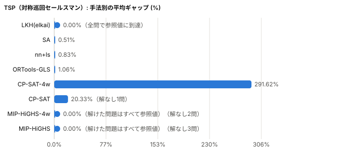
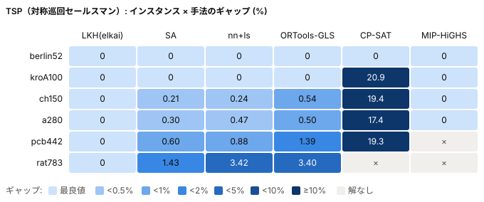
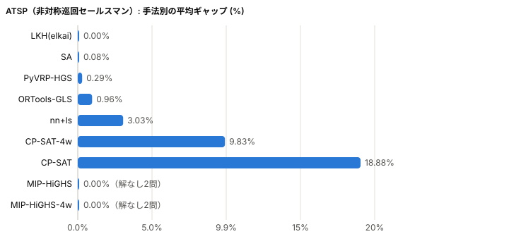
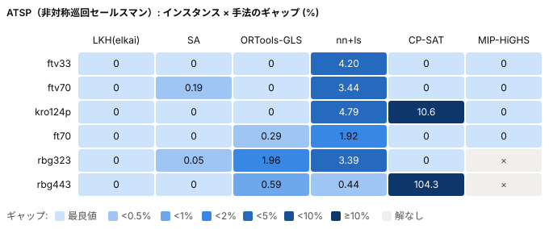
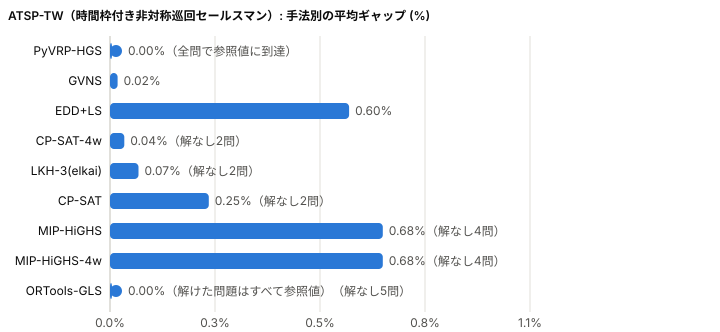
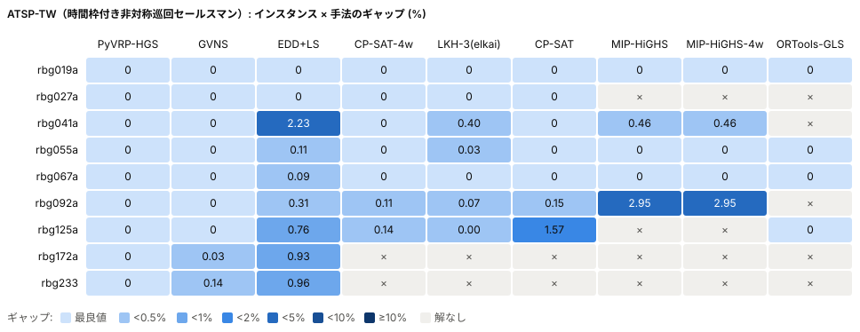
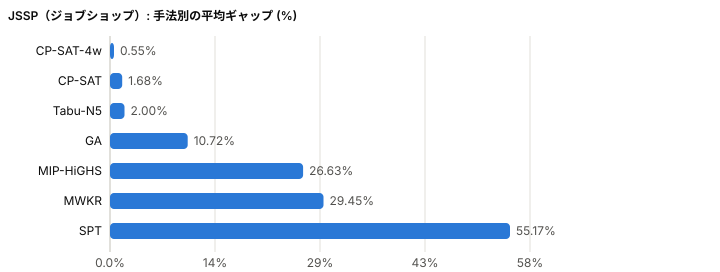
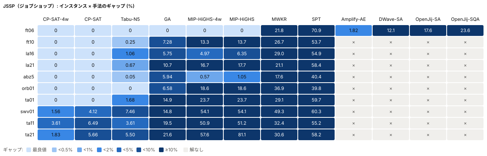
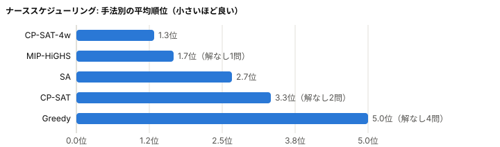
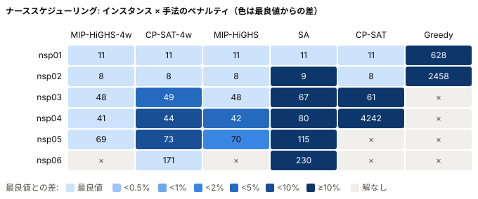

# ベンチマーク結果

このページは `python src/export_web.py` で自動生成しています（手で編集しないでください）。マウスオーバーで詳細が見られ、run を切り替えて比較できる対話型のビューは、手元で `docs/benchmark.html` をダブルクリックすると開きます（入口は `docs/index.html`）。

データ生成: 2026-10-25T12:12:06+00:00

- [TSP（対称巡回セールスマン）](#tsp) / [ATSP（非対称巡回セールスマン）](#atsp) / [ATSP-TW（時間枠付き非対称巡回セールスマン）](#atsptw) / [JSSP（ジョブショップ）](#jssp) / [ナーススケジューリング](#nsp) / [実行履歴](#history)

## TSP（対称巡回セールスマン）

run `20261025T075502Z-tiamat-tsp`（2026-10-25 07:55 UTC 開始）。参照値: TSPLIB 公表最適値。制限時間 60 秒、全手法 1 スレッド（CP-SAT-4w・MIP-HiGHS-4w は 4 スレッド）。確率的手法は複数シードの平均。

実行環境: tiamat: AMD Ryzen 9 5900HX with Radeon Graphics, 16 論理 CPU, メモリ 31.4 GB, Windows-11-10.0.26200-SP0, Python 3.12.9, ortools 9.15.6755, highspy 1.15.1, elkai 2.0.1, numba 0.68.0。コード: commit `bffb27c`

| 手法 | 平均ギャップ (%) | 平均順位 | 解あり | 最良値到達 | 平均時間 (秒) |
|---|---:|---:|---:|---:|---:|
| LKH(elkai) | 0.00 | 1.0 | 6/6 | 6 | 5.5 |
| SA | 0.51 | 2.2 | 6/6 | 3 | 60.0 |
| nn+ls | 0.83 | 2.5 | 6/6 | 2 | 15.4 |
| ORTools-GLS | 1.06 | 3.5 | 6/6 | 2 | 60.1 |
| CP-SAT-4w | 291.62 | 4.2 | 6/6 | 2 | 53.4 |
| CP-SAT | 20.33 | 6.3 | 5/6 | 1 | 53.9 |
| MIP-HiGHS-4w | 0.00 | 3.3 | 4/6 | 4 | 33.6 |
| MIP-HiGHS | 0.00 | 4.5 | 3/6 | 3 | 35.0 |

インスタンス別の平均ギャップ (%)。太字は各インスタンスの最良、× は制限時間内に実行可能解なし。

| インスタンス | LKH(elkai) | SA | nn+ls | ORTools-GLS | CP-SAT-4w | CP-SAT | MIP-HiGHS-4w | MIP-HiGHS |
|---|---:|---:|---:|---:|---:|---:|---:|---:|
| berlin52 | **0** | **0** | **0** | **0** | **0** | **0** | **0** | **0** |
| kroA100 | **0** | **0** | **0** | **0** | **0** | 29.81 | **0** | **0** |
| ch150 | **0** | 0.32 | 0.24 | 0.54 | 1.36 | 31.76 | **0** | **0** |
| a280 | **0** | **0** | 0.47 | 0.50 | 8.65 | 19.74 | **0** | × |
| pcb442 | **0** | 1.03 | 0.88 | 1.87 | 18.58 | 20.34 | × | × |
| rat783 | **0** | 1.68 | 3.42 | 3.48 | 1721.11 | × | × | × |

### スレッド数による違い

平均ギャップ (%) と平均時間（秒）。× は制限時間内に実行可能解なし。平均は全スレッド数で解が得られたインスタンスのみ。

**CP-SAT**

| インスタンス | 1 スレッド | 時間 | 4 スレッド | 時間 |
|---|---:|---:|---:|---:|
| berlin52 | 0.00 | 9.2 | 0.00 | 4.5 |
| kroA100 | 29.81 | 60.5 | 0.00 | 60.5 |
| ch150 | 31.76 | 60.7 | 1.36 | 61.5 |
| a280 | 19.74 | 61.5 | 8.65 | 61.6 |
| pcb442 | 20.34 | 63.2 | 18.58 | 63.2 |
| rat783 | × | 68.6 | 1721.11 | 69.2 |
| 平均（5 問） | 20.33 | 51.0 | 5.72 | 50.2 |

**MIP-HiGHS**

| インスタンス | 1 スレッド | 時間 | 4 スレッド | 時間 |
|---|---:|---:|---:|---:|
| berlin52 | 0.00 | 0.1 | 0.00 | 0.1 |
| kroA100 | 0.00 | 4.0 | 0.00 | 3.5 |
| ch150 | 0.00 | 24.7 | 0.00 | 21.5 |
| a280 | × | 60.5 | 0.00 | 56.3 |
| pcb442 | × | 60.7 | × | 60.2 |
| rat783 | × | 60.2 | × | 60.3 |
| 平均（3 問） | 0.00 | 9.6 | 0.00 | 8.3 |

## ATSP（非対称巡回セールスマン）

run `20261025T081323Z-tiamat-atsp`（2026-10-25 08:13 UTC 開始）。参照値: TSPLIB 公表最適値。制限時間 60 秒、全手法 1 スレッド（CP-SAT-4w・MIP-HiGHS-4w は 4 スレッド）。確率的手法は複数シードの平均。

実行環境: tiamat: AMD Ryzen 9 5900HX with Radeon Graphics, 16 論理 CPU, メモリ 31.4 GB, Windows-11-10.0.26200-SP0, Python 3.12.9, ortools 9.15.6755, highspy 1.15.1, elkai 2.0.1, numba 0.68.0。コード: commit `bffb27c`

| 手法 | 平均ギャップ (%) | 平均順位 | 解あり | 最良値到達 | 平均時間 (秒) |
|---|---:|---:|---:|---:|---:|
| LKH(elkai) | 0.00 | 1.0 | 6/6 | 6 | 8.0 |
| SA | 0.08 | 3.3 | 6/6 | 3 | 60.0 |
| ORTools-GLS | 0.96 | 4.0 | 6/6 | 2 | 60.1 |
| nn+ls | 3.03 | 6.7 | 6/6 | 0 | 6.4 |
| CP-SAT-4w | 9.83 | 1.7 | 6/6 | 5 | 20.9 |
| CP-SAT | 18.88 | 3.0 | 6/6 | 4 | 26.3 |
| MIP-HiGHS | 0.00 | 3.3 | 4/6 | 4 | 22.9 |
| MIP-HiGHS-4w | 0.00 | 3.3 | 4/6 | 4 | 23.0 |

インスタンス別の平均ギャップ (%)。太字は各インスタンスの最良、× は制限時間内に実行可能解なし。

| インスタンス | LKH(elkai) | SA | ORTools-GLS | nn+ls | CP-SAT-4w | CP-SAT | MIP-HiGHS | MIP-HiGHS-4w |
|---|---:|---:|---:|---:|---:|---:|---:|---:|
| ftv33 | **0** | **0** | **0** | 4.20 | **0** | **0** | **0** | **0** |
| ftv70 | **0** | 0.43 | **0** | 3.44 | **0** | **0** | **0** | **0** |
| kro124p | **0** | **0** | 2.02 | 4.79 | **0** | 8.96 | **0** | **0** |
| ft70 | **0** | 0.03 | 0.41 | 1.92 | **0** | **0** | **0** | **0** |
| rbg323 | **0** | 0.03 | 2.71 | 3.39 | **0** | **0** | × | × |
| rbg443 | **0** | **0** | 0.62 | 0.44 | 58.97 | 104.34 | × | × |

### スレッド数による違い

平均ギャップ (%) と平均時間（秒）。× は制限時間内に実行可能解なし。平均は全スレッド数で解が得られたインスタンスのみ。

**CP-SAT**

| インスタンス | 1 スレッド | 時間 | 4 スレッド | 時間 |
|---|---:|---:|---:|---:|
| ftv33 | 0.00 | 1.3 | 0.00 | 0.9 |
| ftv70 | 0.00 | 20.3 | 0.00 | 12.5 |
| kro124p | 8.96 | 60.5 | 0.00 | 32.8 |
| ft70 | 0.00 | 3.0 | 0.00 | 3.4 |
| rbg323 | 0.00 | 9.3 | 0.00 | 12.7 |
| rbg443 | 104.34 | 63.5 | 58.97 | 63.2 |
| 平均（6 問） | 18.88 | 26.3 | 9.83 | 20.9 |

**MIP-HiGHS**

| インスタンス | 1 スレッド | 時間 | 4 スレッド | 時間 |
|---|---:|---:|---:|---:|
| ftv33 | 0.00 | 0.2 | 0.00 | 0.2 |
| ftv70 | 0.00 | 2.8 | 0.00 | 2.3 |
| kro124p | 0.00 | 10.2 | 0.00 | 8.9 |
| ft70 | 0.00 | 1.7 | 0.00 | 1.5 |
| rbg323 | × | 62.0 | × | 65.4 |
| rbg443 | × | 60.4 | × | 59.6 |
| 平均（4 問） | 0.00 | 3.7 | 0.00 | 3.2 |

## ATSP-TW（時間枠付き非対称巡回セールスマン）

run `20261025T111518Z-tiamat-atsptw`（2026-10-25 11:15 UTC 開始）。参照値: 公表最適値（AFG セット）。制限時間 60 秒、全手法 1 スレッド（CP-SAT-4w・MIP-HiGHS-4w は 4 スレッド）。確率的手法は複数シードの平均。

実行環境: tiamat: AMD Ryzen 9 5900HX with Radeon Graphics, 16 論理 CPU, メモリ 31.4 GB, Windows-11-10.0.26200-SP0, Python 3.12.9, ortools 9.15.6755, highspy 1.15.1, elkai 2.0.1, numba 0.68.0。コード: commit `c8ce3fb`

| 手法 | 平均ギャップ (%) | 平均順位 | 解あり | 最良値到達 | 平均時間 (秒) |
|---|---:|---:|---:|---:|---:|
| PyVRP-HGS | 0.00 | 1.0 | 9/9 | 9 | 60.1 |
| GVNS | 0.02 | 1.2 | 9/9 | 7 | 60.0 |
| EDD+LS | 0.60 | 5.1 | 9/9 | 2 | 0.2 |
| CP-SAT-4w | 0.04 | 3.6 | 7/9 | 5 | 34.9 |
| LKH-3(elkai) | 0.07 | 4.6 | 7/9 | 3 | 60.0 |
| CP-SAT | 0.25 | 3.9 | 7/9 | 5 | 37.1 |
| MIP-HiGHS | 0.68 | 5.8 | 5/9 | 3 | 48.6 |
| MIP-HiGHS-4w | 0.68 | 5.8 | 5/9 | 3 | 47.5 |
| ORTools-GLS | 0.00 | 5.4 | 4/9 | 4 | 27.0 |

インスタンス別の平均ギャップ (%)。太字は各インスタンスの最良、× は制限時間内に実行可能解なし。

| インスタンス | PyVRP-HGS | GVNS | EDD+LS | CP-SAT-4w | LKH-3(elkai) | CP-SAT | MIP-HiGHS | MIP-HiGHS-4w | ORTools-GLS |
|---|---:|---:|---:|---:|---:|---:|---:|---:|---:|
| rbg019a | **0** | **0** | **0** | **0** | **0** | **0** | **0** | **0** | **0** |
| rbg027a | **0** | **0** | **0** | **0** | **0** | **0** | × | × | × |
| rbg041a | **0** | **0** | 2.23 | **0** | 0.40 | **0** | 0.46 | 0.46 | × |
| rbg055a | **0** | **0** | 0.11 | **0** | 0.03 | **0** | **0** | **0** | **0** |
| rbg067a | **0** | **0** | 0.09 | **0** | **0** | **0** | **0** | **0** | **0** |
| rbg092a | **0** | **0** | 0.31 | 0.11 | 0.07 | 0.15 | 2.95 | 2.95 | × |
| rbg125a | **0** | **0** | 0.76 | 0.14 | 0.00 | 1.57 | × | × | **0** |
| rbg172a | **0** | 0.03 | 0.93 | × | × | × | × | × | × |
| rbg233 | **0** | 0.14 | 0.96 | × | × | × | × | × | × |

### スレッド数による違い

平均ギャップ (%) と平均時間（秒）。× は制限時間内に実行可能解なし。平均は全スレッド数で解が得られたインスタンスのみ。

**CP-SAT**

| インスタンス | 1 スレッド | 時間 | 4 スレッド | 時間 |
|---|---:|---:|---:|---:|
| rbg019a | 0.00 | 1.5 | 0.00 | 0.4 |
| rbg027a | 0.00 | 12.0 | 0.00 | 2.3 |
| rbg041a | 0.00 | 60.4 | 0.00 | 60.4 |
| rbg055a | 0.00 | 4.5 | 0.00 | 2.9 |
| rbg067a | 0.00 | 12.3 | 0.00 | 5.3 |
| rbg092a | 0.15 | 60.5 | 0.11 | 60.5 |
| rbg125a | 1.57 | 60.6 | 0.14 | 60.5 |
| rbg172a | × | 60.7 | × | 60.7 |
| rbg233 | × | 61.0 | × | 60.9 |
| 平均（7 問） | 0.25 | 30.3 | 0.04 | 27.5 |

**MIP-HiGHS**

| インスタンス | 1 スレッド | 時間 | 4 スレッド | 時間 |
|---|---:|---:|---:|---:|
| rbg019a | 0.00 | 0.1 | 0.00 | 0.1 |
| rbg027a | × | 60.0 | × | 60.0 |
| rbg041a | 0.46 | 60.0 | 0.46 | 60.0 |
| rbg055a | 0.00 | 35.9 | 0.00 | 31.1 |
| rbg067a | 0.00 | 41.1 | 0.00 | 35.7 |
| rbg092a | 2.95 | 60.1 | 2.95 | 60.1 |
| rbg125a | × | 60.1 | × | 60.1 |
| rbg172a | × | 60.3 | × | 60.1 |
| rbg233 | × | 60.1 | × | 60.1 |
| 平均（5 問） | 0.68 | 39.4 | 0.68 | 37.4 |

## JSSP（ジョブショップ）

run `20261025T082601Z-tiamat-jssp`（2026-10-25 08:26 UTC 開始）。参照値: 既知最適値（JSPLIB, ta11/ta21 は文献値）。制限時間 60 秒、全手法 1 スレッド（CP-SAT-4w・MIP-HiGHS-4w は 4 スレッド）。確率的手法は複数シードの平均。

実行環境: tiamat: AMD Ryzen 9 5900HX with Radeon Graphics, 16 論理 CPU, メモリ 31.4 GB, Windows-11-10.0.26200-SP0, Python 3.12.9, ortools 9.15.6755, highspy 1.15.1, elkai 2.0.1, numba 0.68.0。コード: commit `bffb27c`

| 手法 | 平均ギャップ (%) | 平均順位 | 解あり | 最良値到達 | 平均時間 (秒) |
|---|---:|---:|---:|---:|---:|
| CP-SAT-4w | 0.70 | 1.0 | 10/10 | 7 | 23.9 |
| CP-SAT | 1.63 | 1.5 | 10/10 | 7 | 38.8 |
| Tabu-N5 | 2.03 | 2.3 | 10/10 | 2 | 60.0 |
| GA | 10.71 | 4.0 | 10/10 | 1 | 60.0 |
| MIP-HiGHS-4w | 24.05 | 4.7 | 10/10 | 1 | 54.2 |
| MIP-HiGHS | 26.74 | 5.5 | 10/10 | 1 | 54.3 |
| MWKR | 29.45 | 6.4 | 10/10 | 0 | 0.2 |
| SPT | 55.17 | 7.9 | 10/10 | 0 | 0.2 |

インスタンス別の平均ギャップ (%)。太字は各インスタンスの最良、× は制限時間内に実行可能解なし。

| インスタンス | CP-SAT-4w | CP-SAT | Tabu-N5 | GA | MIP-HiGHS-4w | MIP-HiGHS | MWKR | SPT |
|---|---:|---:|---:|---:|---:|---:|---:|---:|
| ft06 | **0** | **0** | **0** | **0** | **0** | **0** | 21.82 | 70.91 |
| ft10 | **0** | **0** | 0.25 | 7.28 | 13.33 | 13.66 | 26.67 | 53.66 |
| la16 | **0** | **0** | 1.06 | 5.75 | 4.97 | 6.35 | 29.00 | 54.92 |
| la21 | **0** | **0** | 0.67 | 10.71 | 16.73 | 17.69 | 21.13 | 58.41 |
| abz5 | **0** | **0** | 0.05 | 5.94 | 0.57 | 1.05 | 17.59 | 40.44 |
| orb01 | **0** | **0** | **0** | 6.58 | 18.60 | 18.60 | 36.92 | 39.85 |
| ta01 | **0** | **0** | 1.68 | 14.92 | 23.72 | 23.72 | 29.08 | 59.71 |
| swv01 | **1.56** | 4.12 | 7.46 | 14.81 | 54.09 | 54.09 | 49.33 | 60.34 |
| ta11 | **3.61** | 6.49 | **3.61** | 19.53 | 50.92 | 51.22 | 32.35 | 55.20 |
| ta21 | **1.83** | 5.66 | 5.50 | 21.56 | 57.61 | 81.06 | 30.63 | 58.22 |

### スレッド数による違い

平均ギャップ (%) と平均時間（秒）。× は制限時間内に実行可能解なし。平均は全スレッド数で解が得られたインスタンスのみ。

**CP-SAT**

| インスタンス | 1 スレッド | 時間 | 4 スレッド | 時間 |
|---|---:|---:|---:|---:|
| ft06 | 0.00 | 0.4 | 0.00 | 0.3 |
| ft10 | 0.00 | 36.4 | 0.00 | 3.0 |
| la16 | 0.00 | 1.5 | 0.00 | 0.6 |
| la21 | 0.00 | 60.4 | 0.00 | 37.5 |
| abz5 | 0.00 | 13.9 | 0.00 | 1.4 |
| orb01 | 0.00 | 60.4 | 0.00 | 9.4 |
| ta01 | 0.00 | 34.2 | 0.00 | 5.5 |
| swv01 | 4.12 | 60.4 | 1.56 | 60.4 |
| ta11 | 6.49 | 60.4 | 3.61 | 60.4 |
| ta21 | 5.66 | 60.4 | 1.83 | 60.4 |
| 平均（10 問） | 1.63 | 38.8 | 0.70 | 23.9 |

**MIP-HiGHS**

| インスタンス | 1 スレッド | 時間 | 4 スレッド | 時間 |
|---|---:|---:|---:|---:|
| ft06 | 0.00 | 0.7 | 0.00 | 0.6 |
| ft10 | 13.66 | 60.1 | 13.33 | 60.1 |
| la16 | 6.35 | 60.1 | 4.97 | 60.1 |
| la21 | 17.69 | 60.2 | 16.73 | 60.1 |
| abz5 | 1.05 | 60.1 | 0.57 | 60.1 |
| orb01 | 18.60 | 60.1 | 18.60 | 60.1 |
| ta01 | 23.72 | 60.2 | 23.72 | 60.2 |
| swv01 | 54.09 | 60.3 | 54.09 | 60.3 |
| ta11 | 51.22 | 60.4 | 50.92 | 60.4 |
| ta21 | 81.06 | 60.5 | 57.61 | 60.5 |
| 平均（10 問） | 26.74 | 54.3 | 24.05 | 54.2 |

## ナーススケジューリング

run `20261025T085847Z-tiamat-nsp`（2026-10-25 08:58 UTC 開始）。参照値: 全 run・全手法中の最良値（合成インスタンス、最適値未知）。制限時間 60 秒、全手法 1 スレッド（CP-SAT-4w・MIP-HiGHS-4w は 4 スレッド）。確率的手法は複数シードの平均。

実行環境: tiamat: AMD Ryzen 9 5900HX with Radeon Graphics, 16 論理 CPU, メモリ 31.4 GB, Windows-11-10.0.26200-SP0, Python 3.12.9, ortools 9.15.6755, highspy 1.15.1, elkai 2.0.1, numba 0.68.0。コード: commit `bffb27c`

| 手法 | 平均順位 | 平均ペナルティ差 (%) | 解あり | 最良値到達 | 平均時間 (秒) |
|---|---:|---:|---:|---:|---:|
| MIP-HiGHS-4w | 1.8 | 0.00 | 5/6 | 5 | 31.5 |
| CP-SAT-4w | 2.0 | 2.53 | 6/6 | 3 | 40.7 |
| MIP-HiGHS | 2.2 | 0.78 | 5/6 | 3 | 31.7 |
| SA | 3.5 | 42.09 | 6/6 | 1 | 60.0 |
| CP-SAT | 3.8 | 2568.36 | 4/6 | 2 | 40.9 |
| Greedy | 6.0 | 18117.05 | 2/6 | 0 | 0.9 |

インスタンス別のペナルティの平均値。太字は各インスタンスの最良、× は制限時間内に実行可能解なし。

| インスタンス | MIP-HiGHS-4w | CP-SAT-4w | MIP-HiGHS | SA | CP-SAT | Greedy |
|---|---:|---:|---:|---:|---:|---:|
| nsp01 | **11** | **11** | **11** | **11** | **11** | 628 |
| nsp02 | **8** | **8** | **8** | 9 | **8** | 2458 |
| nsp03 | **48** | 49 | **48** | 67 | 61 | × |
| nsp04 | **41** | 44 | 42 | 80 | 4242 | × |
| nsp05 | **69** | 73 | 70 | 115 | × | × |
| nsp06 | × | **171** | × | 230 | × | × |

### スレッド数による違い

ペナルティの平均値と平均時間（秒）。× は制限時間内に実行可能解なし。平均は全スレッド数で解が得られたインスタンスのみ。

**CP-SAT**

| インスタンス | 1 スレッド | 時間 | 4 スレッド | 時間 |
|---|---:|---:|---:|---:|
| nsp01 | 11 | 0.6 | 11 | 0.5 |
| nsp02 | 8 | 2.1 | 8 | 0.6 |
| nsp03 | 61 | 60.6 | 49 | 60.6 |
| nsp04 | 4242 | 60.7 | 44 | 60.7 |
| nsp05 | × | 60.6 | 73 | 60.7 |
| nsp06 | × | 60.9 | 171 | 61.0 |
| 平均（4 問、最良値との差 %） | 2568.36 | 31.0 | 2.35 | 30.6 |

**MIP-HiGHS**

| インスタンス | 1 スレッド | 時間 | 4 スレッド | 時間 |
|---|---:|---:|---:|---:|
| nsp01 | 11 | 0.3 | 11 | 0.3 |
| nsp02 | 8 | 0.4 | 8 | 0.4 |
| nsp03 | 48 | 6.8 | 48 | 6.1 |
| nsp04 | 42 | 60.6 | 41 | 60.5 |
| nsp05 | 70 | 60.7 | 69 | 60.6 |
| nsp06 | × | 61.2 | × | 61.1 |
| 平均（5 問、最良値との差 %） | 0.78 | 25.8 | 0.00 | 25.6 |

## 実行履歴

`results/runs/<run_id>/` に run ごとの `run.json`（メタデータ）・`results.jsonl`（生データ）・`summary.csv`（集計）があります。各問題の上の表は最新の run です。

| run_id | 問題 | 開始日時 (UTC) | 実行環境 | 制限時間 | commit | メモ |
|---|---|---|---|---:|---|---|
| `20261025T111518Z-tiamat-atsptw` | atsptw | 2026-10-25 11:15 | tiamat (16 CPU) | 60 秒 | `c8ce3fb` | 手元PC（Windows 11, 16 論理 CPU）で 1 スレッドと 4 ス… |
| `20261025T104324Z-cloud-atsptw` | atsptw | 2026-10-25 10:43 | cloud (4 CPU) | 60 秒 | `c0b2d1a` | クラウドでの試走（4 vCPU）。LKH-3(elkai) は試走中に設定を変え… |
| `20261025T085847Z-tiamat-nsp` | nsp | 2026-10-25 08:58 | tiamat (16 CPU) | 60 秒 | `bffb27c` | 手元PC（Windows 11, 16 論理 CPU）で 1 スレッドと 4 ス… |
| `20261025T082601Z-tiamat-jssp` | jssp | 2026-10-25 08:26 | tiamat (16 CPU) | 60 秒 | `bffb27c` | 手元PC（Windows 11, 16 論理 CPU）で 1 スレッドと 4 ス… |
| `20261025T081323Z-tiamat-atsp` | atsp | 2026-10-25 08:13 | tiamat (16 CPU) | 60 秒 | `bffb27c` | 手元PC（Windows 11, 16 論理 CPU）で 1 スレッドと 4 ス… |
| `20261025T075502Z-tiamat-tsp` | tsp | 2026-10-25 07:55 | tiamat (16 CPU) | 60 秒 | `bffb27c` | 手元PC（Windows 11, 16 論理 CPU）で 1 スレッドと 4 ス… |
| `20261025T050501Z-cloud-tsp` | tsp | 2026-10-25 05:05 | cloud (4 CPU) | 60 秒 | `99b5f2e` | 既存結果（results/tsp.jsonl）からの移行。開始・終了日時は記録が… |
| `20261025T050501Z-cloud-nsp` | nsp | 2026-10-25 05:05 | cloud (4 CPU) | 60 秒 | `99b5f2e` | 既存結果（results/nsp.jsonl）からの移行。開始・終了日時は記録が… |
| `20261025T050501Z-cloud-jssp` | jssp | 2026-10-25 05:05 | cloud (4 CPU) | 60 秒 | `99b5f2e` | 既存結果（results/jssp.jsonl）からの移行。開始・終了日時は記録… |
| `20261025T050501Z-cloud-atsp` | atsp | 2026-10-25 05:05 | cloud (4 CPU) | 60 秒 | `99b5f2e` | 既存結果（results/atsp.jsonl）からの移行。開始・終了日時は記録… |

commit の `*` は未コミットの変更がある状態で実行したことを示します。
